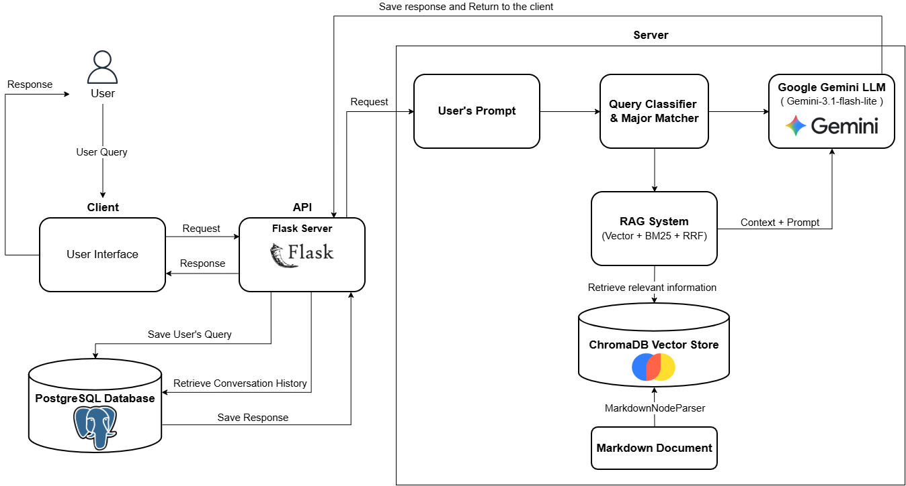

# CTU Advisor — Chatbot tư vấn học vụ Đại học Cần Thơ

Ứng dụng web hỗ trợ tra cứu chương trình đào tạo và quy chế học vụ bằng tiếng Việt, kết hợp **Retrieval-Augmented Generation (RAG)**, **Hybrid Search** và **Google Gemini**. Dự án triển khai luồng từ xử lý tài liệu Markdown, xây dựng chỉ mục tìm kiếm đến giao diện chat có đăng nhập và lưu hội thoại bằng PostgreSQL.

Đây là project phục vụ học tập và trình bày năng lực phát triển ứng dụng AI. Thông tin trả lời cần được đối chiếu với văn bản của trường; dự án không đại diện cho kênh tư vấn chính thức của Đại học Cần Thơ.

Link Demo Giao diện: https://lambent-blini-161fb6.netlify.app/

## Chức năng đã triển khai

- **Hỏi đáp theo tài liệu:** tra cứu thông tin ngành học, tín chỉ, môn học và quy chế trong bộ dữ liệu được cung cấp.
- **Nhận diện ngành học:** mở rộng viết tắt như `cntt`, `ktpm`, `httt`, `clc`; khớp tên ngành bằng quy tắc và điểm từ khóa.
- **Hai nhánh truy xuất:** lấy các đoạn tài liệu theo metadata khi xác định được ngành; dùng Vector Search + BM25 + Reciprocal Rank Fusion (RRF) khi không xác định được ngành.
- **Hội thoại có ngữ cảnh:** dùng lịch sử để nhận diện ngành đang trao đổi và đưa tối đa 5 lượt gần nhất vào prompt.
- **Tài khoản và lịch sử:** đăng ký, đăng nhập, cập nhật thông tin cá nhân; tạo, đổi tên, xem và xóa hội thoại. Nội dung được lưu trong PostgreSQL theo tài khoản.
- **Quản trị tài liệu:** tài khoản admin tải lên Markdown và theo dõi tác vụ cập nhật vector database chạy nền.
- **Giao diện web:** hiển thị Markdown, chuyển chế độ sáng/tối, quản lý hội thoại ở thanh bên.
- **Công cụ đánh giá:** có sẵn bộ câu hỏi trong `data/evaluate`, script sinh câu trả lời kèm ngữ cảnh và chấm bằng RAGAS.

## Công nghệ

| Thành phần                  | Công nghệ / cấu hình trong code                                                  |
| ----------------------------- | ------------------------------------------------------------------------------------ |
| Backend                       | Python, Flask, Flask-Login, Flask-CORS                                               |
| Frontend                      | HTML, CSS, JavaScript, Jinja2, Marked                                                |
| Điều phối RAG              | LlamaIndex                                                                           |
| Mô hình sinh câu trả lời | Google Gemini, model ID `gemini-3.1-flash-lite`, temperature `0.0`               |
| Embedding đa ngôn ngữ      | Hugging Face `Alibaba-NLP/gte-multilingual-base`, chạy local trên CPU hoặc CUDA |
| Tìm kiếm                    | Vector Search + BM25, hợp nhất bằng RRF                                           |
| Lưu vector                   | ChromaDB, collection `ctu_courses`                                                 |
| Tài khoản và hội thoại   | PostgreSQL, psycopg2, băm mật khẩu bằng Werkzeug                                 |
| Đánh giá tùy chọn        | RAGAS, pandas, LangChain, Hugging Face                                               |

Model Gemini phải khả dụng với API key của bạn. Nếu cần đổi model, cập nhật cấu hình trong [generator.py](src/generator.py) và các script đánh giá tương ứng.

## Kiến trúc hệ thống và cách hoạt động



### 1. Xây dựng dữ liệu

```text
Markdown + YAML frontmatter
    → Đọc metadata và gán ID tài liệu
    → MarkdownNodeParser chia đoạn theo cấu trúc Markdown
    → Hugging Face Embedding
    → ChromaDB lưu nội dung, metadata và vector
```

[retriever.py](src/retriever.py) dùng SHA-256 để phát hiện tài liệu mới, thay đổi hoặc bị xóa. Hàm xây dựng chỉ mục hỗ trợ cập nhật tăng dần, xóa vector cũ của tài liệu thay đổi và bỏ qua tài liệu giữ nguyên.

Repository có sẵn tài liệu Markdown trong [data/processed/DaiHoc](data/processed/DaiHoc). Pipeline chuyển PDF sang Markdown chưa có script trong phiên bản hiện tại; hãy chuẩn bị Markdown trước khi lập chỉ mục.

### 2. Xử lý câu hỏi

```text
Trình duyệt → Flask → Đọc lịch sử từ PostgreSQL → Khớp ngành
    ├─ Có ngành: lấy các đoạn có metadata nganh_hoc tương ứng
    └─ Chưa xác định ngành: Vector Search + BM25 → RRF → ngữ cảnh
        → Gemini tạo câu trả lời → Lưu PostgreSQL → Trả về giao diện
```

- Bộ khớp ngành tìm trong câu hỏi hiện tại, sau đó tìm ngược trong lịch sử người dùng.
- Nhánh Hybrid Search lấy top 20 từ mỗi retriever và hợp nhất thành top 20; `num_queries=1` dùng câu truy vấn đầu vào, không sinh thêm truy vấn.
- Prompt yêu cầu trả lời theo tài liệu và thông báo khi thiếu thông tin. Đây là hướng dẫn cho mô hình, không bảo đảm loại bỏ hoàn toàn câu trả lời sai.
- PostgreSQL lưu các bảng `users`, `conversations`, `messages`. LocalStorage chỉ lưu tùy chọn giao diện và ID hội thoại đang mở.

Sơ đồ mô tả kiến trúc tổng thể. Khối “Query Classifier & Major Matcher” hiện được hiện thực bằng quy tắc khớp ngành trong [generator.py](src/generator.py), chưa có mô hình phân loại truy vấn riêng.

## Cấu trúc repository

```text
CTU_Advisor/
├── src/
│   ├── main.py                 # Flask, xác thực, API chat, quản trị tài liệu
│   ├── generator.py            # Khớp ngành, Hybrid Search, prompt và gọi Gemini
│   ├── retriever.py            # Xây dựng / cập nhật chỉ mục ChromaDB
│   ├── database.py             # Khởi tạo bảng và thao tác PostgreSQL
│   ├── migrate_db.py           # Script chuyển schema cũ; có thao tác DROP TABLE
│   ├── run_batch_and_export.py # Sinh answer + contexts cho bộ câu hỏi
│   ├── eval_ragas.py           # Chấm kết quả bằng RAGAS
│   ├── templates/              # Trang chat, đăng nhập và đăng ký
│   └── static/                 # JavaScript, CSS và logo
├── data/processed/DaiHoc/      # Chương trình đào tạo và quy chế dạng Markdown
├── data/evaluate/              # Bộ câu hỏi, dữ liệu đánh giá và kết quả RAGAS
├── ApplicationArchitecture.png
├── requirements.txt
└── README.md
```

Các thành phần tạo tại máy chạy gồm file cấu hình `.env`, thư mục `vector_db/` và file trạng thái `processed_state.json`. PDF gốc trong `data/raw/` không được đưa lên Git theo cấu hình hiện tại.

## Cài đặt và chạy local

### 1. Yêu cầu

- Python **3.12** là phiên bản dùng trong môi trường phát triển hiện tại; chưa có ma trận kiểm thử phiên bản khác.
- PostgreSQL đang chạy và tài khoản có quyền tạo bảng trong database dự án.
- [Google API key](https://aistudio.google.com/apikey) có quyền sử dụng model Gemini cấu hình trong code.
- Kết nối Internet để tải embedding model lần đầu và gọi Gemini. GPU NVIDIA là tùy chọn; code tự chọn CUDA nếu khả dụng, nếu không sẽ dùng CPU.

**Đường dẫn cache:** [main.py](src/main.py) và [retriever.py](src/retriever.py) hiện đặt `HF_HOME` và `LLAMA_INDEX_CACHE_DIR` thành `D:\AI_Models_Cache`. Trước khi chạy trên máy khác, sửa hai giá trị này sang thư mục có quyền ghi hoặc bỏ các dòng gán để dùng cache mặc định.

### 2. Lấy mã nguồn và tạo môi trường

```bash
git clone https://github.com/minhchanhtrang/CTU_Advisor.git
cd CTU_Advisor
python -m venv .venv
```

Kích hoạt trên Windows PowerShell:

```powershell
.\.venv\Scripts\Activate.ps1
```

Hoặc trên Linux/macOS:

```bash
source .venv/bin/activate
```

Cài dependency:

```bash
python -m pip install --upgrade pip
python -m pip install -r requirements.txt
```

[requirements.txt](requirements.txt) bao gồm các thư viện cho ứng dụng web, pipeline RAG và công cụ đánh giá. Các dependency chưa được khóa phiên bản. Nếu muốn dùng CUDA, chọn bản PyTorch phù hợp tại [hướng dẫn chính thức](https://pytorch.org/get-started/locally/).

### 3. Cấu hình môi trường

Tạo file `.env` ở thư mục gốc với nội dung dưới đây. Thay các giá trị mẫu bằng cấu hình của bạn và không commit file chứa khóa thật.

```dotenv
GOOGLE_API_KEY=your_google_api_key
SECRET_KEY=replace_with_a_long_random_secret
POSTGRES_HOST=localhost
POSTGRES_PORT=5432
POSTGRES_DB=ctu_chatbot
POSTGRES_USER=postgres
POSTGRES_PASSWORD=your_postgres_password
```

`SECRET_KEY` dùng để ký session Flask. `LLAMA_CLOUD_API_KEY` không cần cho luồng chạy Markdown → RAG hiện tại.

### 4. Tạo PostgreSQL database

Trong `psql` hoặc Query Tool của pgAdmin, chạy bằng tài khoản có quyền tạo database:

```sql
CREATE DATABASE ctu_chatbot;
```

Tên database và thông tin kết nối phải khớp file cấu hình. Ứng dụng tự tạo các bảng cần thiết khi khởi động; không cần chạy [migrate_db.py](src/migrate_db.py) để cài mới. Script đó xóa bảng dữ liệu cũ và chỉ dành cho trường hợp chuyển schema có chủ đích.

### 5. Xây dựng vector database

Chạy từ thư mục gốc repository:

```bash
python src/retriever.py
```

Lần đầu sẽ tải embedding model, chia đoạn tài liệu và lưu vector vào `vector_db/`. Thời gian xử lý phụ thuộc CPU/GPU và lượng tài liệu. Dù embedding chạy local, hàm build hiện vẫn yêu cầu `GOOGLE_API_KEY` trong môi trường.

Để thêm tài liệu, đặt Markdown trong cây thư mục `data/processed/`. Nên có YAML frontmatter như sau để hỗ trợ lọc theo ngành:

```yaml
---
loai_tai_lieu: "Chương trình đào tạo"
trinh_do: "Đại học"
nganh_hoc: "Kỹ thuật Phần mềm"
nam_ban_hanh: 2025
---
```

Nội dung tài liệu đặt sau frontmatter, dùng heading Markdown để tạo cấu trúc đoạn. Xem [tài liệu Kỹ thuật Phần mềm](data/processed/DaiHoc/70_7480103_KyThuatPhanMem.md) làm ví dụ.

### 6. Khởi động và dùng thử

```bash
python src/main.py
```

Mở **http://localhost:5000**, đăng ký tài khoản rồi đặt câu hỏi, ví dụ:

- “Ngành Kỹ thuật phần mềm có bao nhiêu tín chỉ?”
- “Chương trình CNTT chất lượng cao có những học phần nào?”
- “Điều kiện xét tốt nghiệp được quy định như thế nào?”

Có thể kiểm tra trạng thái khởi tạo chatbot tại **http://localhost:5000/api/status**. Endpoint này không kiểm tra đầy đủ kết nối PostgreSQL hoặc khả năng gọi Gemini.

### 7. Quản trị tài liệu (tùy chọn)

Sau khi đăng ký tài khoản, cấp quyền admin trong database dự án:

```sql
UPDATE users SET is_admin = TRUE WHERE username = 'your_username';
```

Đăng nhập lại để dùng chức năng tải lên Markdown. Tác vụ build chạy nền, giao diện theo dõi log qua API. **Khởi động lại server sau khi build hoàn tất** để nạp lại BM25 và danh sách ngành đang giữ trong bộ nhớ.

Nếu muốn mở PDF từ nguồn tham khảo, bổ sung file gốc vào `data/raw/DaiHoc/`, đặt cùng tên với Markdown nhưng đổi đuôi thành `.pdf`. Bản clone không có PDF gốc nên các liên kết này có thể trả về 404; mức độ hiển thị nguồn còn phụ thuộc nhánh trả lời và đầu ra của mô hình.

## API chính

Các API chat, hội thoại và tài khoản yêu cầu session đăng nhập; API quản trị yêu cầu thêm quyền admin.

| Phương thức | Endpoint                             | Chức năng                                                                             |
| -------------- | ------------------------------------ | --------------------------------------------------------------------------------------- |
| GET            | `/api/status`                      | Trạng thái khởi tạo chatbot                                                         |
| POST           | `/api/chat`                        | Nhận `message`, tùy chọn `conversation_id`; trả `answer`, `conversation_id` |
| GET / POST     | `/api/conversations`               | Liệt kê / tạo hội thoại                                                            |
| GET            | `/api/conversations/<id>/messages` | Lấy tin nhắn hội thoại                                                              |
| PATCH          | `/api/conversations/<id>/title`    | Đổi tên hội thoại                                                                  |
| DELETE         | `/api/conversations/<id>`          | Xóa hội thoại                                                                        |
| DELETE         | `/api/conversations/all`           | Xóa toàn bộ hội thoại của tài khoản                                             |
| GET            | `/api/me`                          | Thông tin tài khoản                                                                  |
| POST           | `/api/me/update`                   | Cập nhật thông tin hoặc mật khẩu                                                  |
| POST           | `/admin/upload`                    | Upload Markdown, trả `job_id`                                                        |
| GET            | `/admin/rebuild-status/<job_id>`   | Trạng thái và log cập nhật chỉ mục                                               |

## Đánh giá RAG (tùy chọn)

Repository có sẵn bộ câu hỏi đánh giá, dữ liệu đầu vào đã điền và báo cáo kết quả trong [data/evaluate](data/evaluate). Các tệp này giúp theo dõi và tái lập quy trình đánh giá RAG.

1. Cài các thư viện (nếu chưa thực hiện ở bước cài đặt):

   ```bash
   python -m pip install -r requirements.txt
   ```
2. Sử dụng [ragas_input_template.xlsx](data/evaluate/ragas_input_template.xlsx) trong thư mục `data/evaluate`, sheet `ragas_data`, với các cột `id`, `question`, `ground_truth`.
3. Kiểm tra cấu hình `ONLY_IDS` trong cả hai script. Hiện chúng chứa danh sách ID cố định; đặt `[]` nếu muốn xử lý toàn bộ bộ câu hỏi.
4. Chạy từ thư mục gốc, sau khi đã build vector database:

   ```bash
   python src/run_batch_and_export.py
   python src/eval_ragas.py
   ```

Script đầu xuất [ragas_input_filled.xlsx](data/evaluate/ragas_input_filled.xlsx) gồm câu hỏi, câu trả lời và ngữ cảnh; script sau xuất [ragas_ket_qua.csv](data/evaluate/ragas_ket_qua.csv). Các metric gồm faithfulness, answer relevancy, context precision, context recall và answer correctness. Quá trình chấm có gọi API và chịu giới hạn quota.

Luồng batch không sử dụng lịch sử hội thoại, do đó kết quả này chưa đánh giá khả năng trả lời nhiều lượt của ứng dụng web.

## Tính năng nổi bật

- **Hỏi đáp học vụ bằng tiếng Việt:** hỗ trợ tra cứu chương trình đào tạo, học phần, tín chỉ và quy chế học vụ từ kho tài liệu của Đại học Cần Thơ.
- **RAG kết hợp Hybrid Search:** kết hợp Vector Search, BM25 và Reciprocal Rank Fusion (RRF) để tìm kiếm ngữ cảnh phù hợp trước khi tạo câu trả lời.
- **Nhận diện ngành học linh hoạt:** hiểu tên ngành, cách viết tắt và thông tin ngành được nhắc đến trong lịch sử hội thoại.
- **Hội thoại nhiều lượt có ngữ cảnh:** ghi nhớ các lượt trao đổi gần nhất, giúp người dùng đặt câu hỏi tiếp nối tự nhiên mà không cần lặp lại toàn bộ nội dung.
- **Trả lời dựa trên nguồn tài liệu:** mô hình được yêu cầu bám sát ngữ cảnh truy xuất và thông báo khi tài liệu không có đủ thông tin để trả lời.
- **Quản lý tài khoản và hội thoại:** đăng ký, đăng nhập, cập nhật thông tin cá nhân, tạo và đổi tên hội thoại; dữ liệu được lưu riêng theo từng tài khoản trong PostgreSQL.
- **Quản trị và cập nhật dữ liệu:** admin có thể tải tài liệu Markdown, theo dõi tiến trình xây dựng lại vector database và cập nhật dữ liệu theo cơ chế tăng dần.
- **Giao diện web thân thiện:** hỗ trợ hiển thị Markdown, chuyển đổi giao diện sáng/tối và quản lý các cuộc hội thoại trực tiếp từ thanh bên.
- **Đánh giá chất lượng RAG:** tích hợp công cụ sinh dữ liệu đánh giá và chấm bằng các chỉ số RAGAS như faithfulness, answer relevancy, context precision và context recall.

## Tác giả

**Trang Minh Chánh**

GitHub: [minhchanhtrang](https://github.com/minhchanhtrang)
